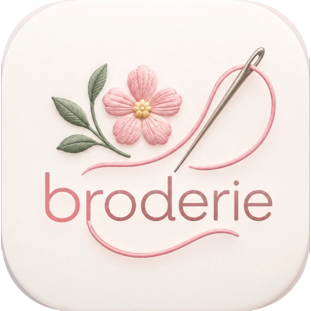
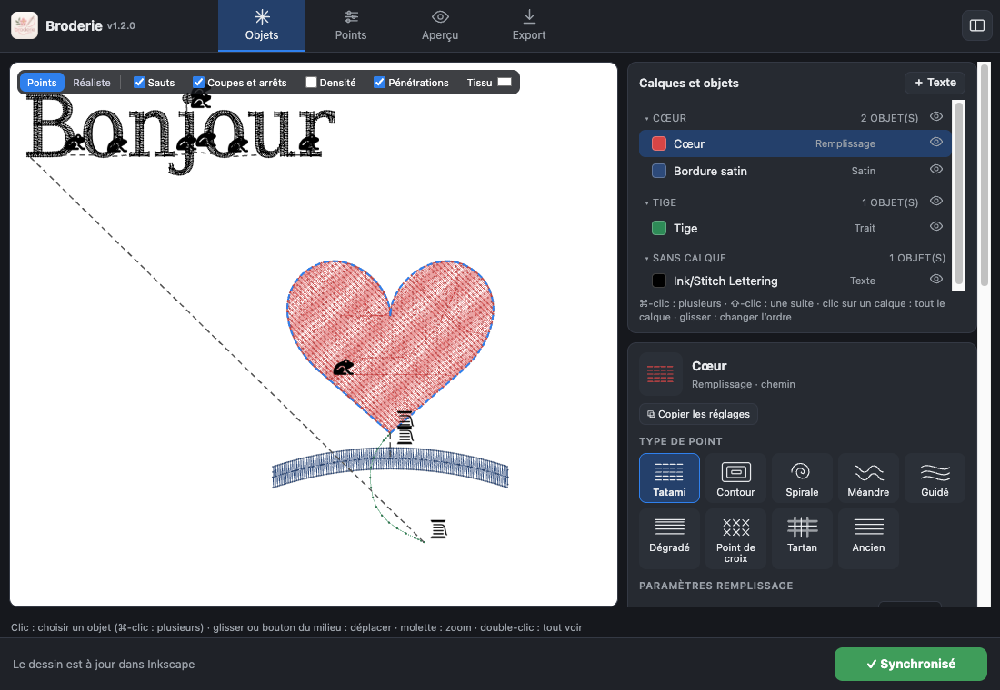

# Panneau de broderie pour Inkscape

Une interface simple pour [Ink/Stitch](https://inkstitch.org), dans [Inkscape](https://inkscape.org).

On **dessine dans Inkscape**, on **règle la broderie dans le panneau**, et **Ink/Stitch calcule les points**. Un seul geste relie les deux : **Cmd+Option+B**.

## Ce que fait le panneau

- **Objets**
  - Calques et objets : sélection multiple avec réglages communs, ordre par glisser-déposer, œil pour broder ou non.
  - Types de point en tuiles et réglages essentiels en curseurs ; tous les réglages d'Ink/Stitch rangés par thèmes.
  - Copier et coller des réglages.
  - Colonnes satin : conversion d'un trait, assemblage des rails et traverses.
  - Texte brodé (140 polices) avec aperçu en direct : droit, en arc (jusqu'au cercle) ou sur une courbe dessinée dans Inkscape.
- **Aperçu**
  - Points d'aiguille, sauts, coupes et changements de couleur.
  - Rendu réaliste sur tissu.
- **Points** : simulation complète, comme le simulateur d'Ink/Stitch.
- **Export**
  - 21 formats de machine.
  - Cadres de la brodeuse, motif centré dans le cadre.
  - Durée estimée.
- **Toutes les commandes Ink/Stitch**, en français.

## Installer

Il faut Inkscape 1.4 et Ink/Stitch 3, testés avec Inkscape 1.4.2 et Ink/Stitch 3.3.0 sur macOS.

1. Téléchargez la dernière version (onglet *Releases*) et décompressez-la.
2. Double-cliquez sur `installer.command`. Si macOS refuse : clic droit › Ouvrir › Ouvrir.
3. Quittez puis relancez Inkscape.
4. Appuyez sur **Cmd+Option+B**.

Mode d'emploi complet et astuces de réglages : [docs/Notice-Broderie-1.2.0.pdf](docs/Notice-Broderie-1.2.0.pdf).

## Où sont les réglages ?

Dans votre fichier `.svg`, exactement comme Ink/Stitch les enregistre. Le dessin reste utilisable avec les menus Ink/Stitch habituels.

## Versions

Numérotation `MAJEUR.MINEUR.CORRECTIF`, détail dans [CHANGELOG.md](CHANGELOG.md).

## Licence

GPL v3, comme Ink/Stitch, dont le panneau reprend les libellés et la liste des réglages. Ink/Stitch et Inkscape ne sont pas inclus : le panneau utilise ceux qui sont installés.
